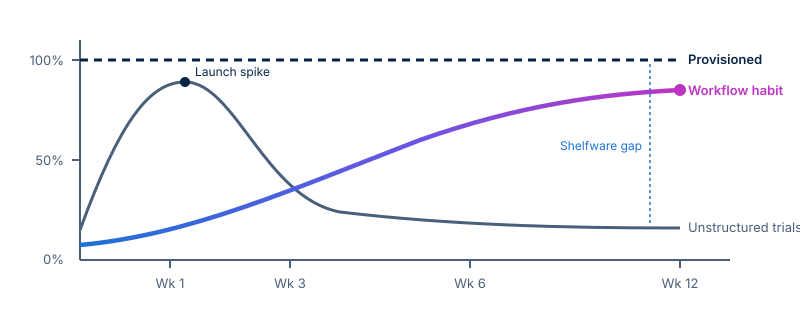
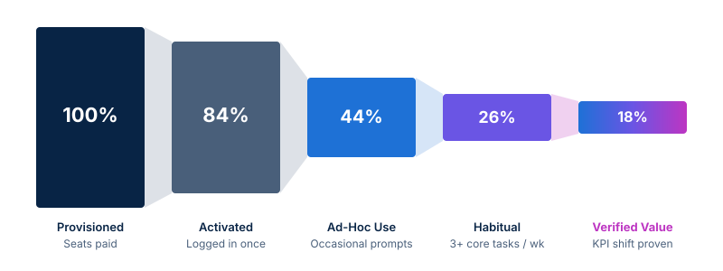

<!-- course-title: Measuring Transformation Change -->
<!-- course-theme: roi-alt-theme -->

<!-- layout: title -->


Measuring Transformation Change

# Chapter 1: Defining Success in Technology Transformation

---

# Chapter 1: Objectives

- Define outcome-driven success criteria for Generative AI and coding agent rollouts
- Audit past technology rollouts to surface common adoption and measurement gaps
- Explain how Generative AI and coding agents alter traditional change management demands
- Distinguish superficial tool provisioning from sustained behavioral adoption in daily work
- Formulate clear, outcome-driven success criteria tied to organizational goals
- Align stakeholders on transformation success definitions that go beyond license activation

---

<!-- layout: navigation -->
# Chapter 1

- **Do-Now: Auditing Past Technology Rollouts**
- Change Management for Generative AI and Coding Agents
- Tool Provisioning vs. Behavioral Adoption
- Defining Outcome-Driven Success Criteria
- Discussion: Defining Success Beyond License Activation

---

<!-- layout: 2-column -->
# Do-Now: Auditing Past Technology Rollouts

### Silent Reflection (3 Minutes)
- Recall one major software or workflow rollout your organization ran in the past three years
- Write down how leadership officially declared the rollout a “success” at launch
- Note what daily work actually looked like six months later

### Pair and Share (5 Minutes)
- Compare your rollout stories with a partner or small table group
- Identify the single moment where reported metrics diverged from reality on the floor
- Select one pattern to share with the room

<!-- below-columns -->

> [!TIP]
> Choose a rollout you observed closely - such as a CRM migration, collaboration platform, cloud tool, or early AI pilot.

---

<!-- layout: card-layout -->
# Four Traps That Hide Rollout Failure

### Go-Live Victory Laps
- Project teams disband as soon as IT deploys licenses and closes the technical ticket.
- Nobody owns what happens during weeks four through twelve when real workflow friction appears.

### Attendance as Proficiency
- Leaders count webinar headcount or LMS completions and assume employees changed how they work.
- Watching a 45-minute feature demo rarely equips someone to redesign a high-pressure daily task.

### Anecdotal Reporting
- Steering committees rely on three enthusiastic early adopters instead of broad behavioral data.
- Silent non-adopters revert to legacy spreadsheets and manual habits without triggering an alert.

### Unmeasured Workarounds
- Teams technically log into the new system while keeping shadow processes alive on the side.
- Cycle times stay flat or worsen even though executive dashboards show green status indicators.

---

# Why Transformation Measurement Breaks Early

- Most rollouts fail in measurement because success was defined as an IT milestone, not a human behavior shift
  - Project charters track budget, schedule, and seat deployment because those numbers are easy to count
  - Business value only appears when people retire old habits and trust new workflows under deadline pressure
- If you wait until contract renewal to ask what changed, baseline data and stakeholder momentum are already gone
- Generative AI amplifies this blind spot because the software installs in minutes while the work redesign takes months

> [!IMPORTANT]
> You cannot measure transformation effectiveness at day 90 if you only defined technical installation goals on day 1.

---

<!-- layout: navigation -->
# Chapter 1

- Do-Now: Auditing Past Technology Rollouts
- **Change Management for Generative AI and Coding Agents**
- Tool Provisioning vs. Behavioral Adoption
- Defining Outcome-Driven Success Criteria
- Discussion: Defining Success Beyond License Activation

---

<!-- layout: 2-column -->
# Deterministic Software vs. Generative AI Rollouts

### Traditional Enterprise Software
- Fixed menus, required form fields, and predictable outputs
- One standard operating procedure works the same way every time
- System enforces compliance by blocking old screens or workflows
- Primary user skill is navigation and data entry accuracy

### Generative AI and Coding Agents
- Open-ended blank prompt box or autonomous multi-step execution
- Probabilistic outputs vary by context, prompt framing, and model behavior
- Completely optional in the moment - legacy habits still work right beside it
- Primary user skill is task decomposition, delegation, and critical verification

<!-- below-columns -->

> [!NOTE]
> Traditional software changes *where* people click; Generative AI and coding agents change *how* people think, draft, and review.

---

<!-- layout: 3-column -->
# The New AI Enablement Landscape

### Chat Assistants
- Tools like Claude, Gemini, and Microsoft 365 Copilot chat
- Used for synthesis, drafting, brainstorming, and policy or document Q and A
- Risk: employees treat them like a search engine, get generic prose, and stop using them

### Embedded Workspace AI
- Tools integrated directly inside docs, spreadsheets, email, and meeting suites
- Used to summarize threads, structure action items, and transform existing drafts
- Risk: passive reliance on summaries without checking source nuances or missing context

### Coding Agents
- Tools like GitHub Copilot, Claude Code, and IDE agent workflows
- Used to plan multi-file edits, generate tests, refactor legacy code, and run commands
- Risk: unreviewed code merges, architectural drift, and review bottlenecks downstream

---

# Demo: Watching Discretionary AI Stall in Real Time

- Open an enterprise assistant (Claude, Gemini, or Copilot) on a delayed customer onboarding escalation and compare two live runs:

```text
Run 1 - Untrained Day-2 Habit:
"Write a reply to an enterprise client angry that onboarding is two weeks late."
-> Polished generic apology; invents timeline promises; misses contract SLA rules.

Run 2 - Workflow-Scoped Delegation:
"Using the 4 sanitized ticket notes and Tier-1 SLA rules below, list unresolved
blockers first, flag any missing dates for human sign-off, then draft a 120-word update."
-> Surfaces an unconfirmed cutover date before drafting; aligns tone to SLA policy.
```

- Ask the room after Run 1: *Would you send that draft, or spend 15 minutes rewriting it and decide manual work is faster?*

> [!NOTE]
> Across functions, AI shifts effort from typing to **review gates** - whether a pull-request (PR) code diff in engineering, a contract redline in legal, or a QA audit in support.

---

# Psychological and Workflow Friction Unique to AI

- High psychological friction slows AI adoption even when licenses are free and accessible
  - **Verification anxiety:** fear of shipping hallucinated facts, subtle code bugs, or insecure outputs
  - **Competence threat:** top performers worry that delegating craft to an agent dilutes their expertise or role value
  - **Policy ambiguity:** uncertainty over what customer data, source code, or internal documents are safe to share
  - **The blank-page stall:** staring at an open chat window under a tight deadline takes more cognitive effort than using yesterday’s template
- Effective change management removes policy ambiguity first and teaches verification habits alongside prompting

> [!WARNING]
> Mandating prompt counts without clear data guardrails and review standards drives shadow AI use or superficial compliance.

---

<!-- layout: navigation -->
# Chapter 1

- Do-Now: Auditing Past Technology Rollouts
- Change Management for Generative AI and Coding Agents
- **Tool Provisioning vs. Behavioral Adoption**
- Defining Outcome-Driven Success Criteria
- Discussion: Defining Success Beyond License Activation

---

<!-- layout: stacked -->
# The Novelty Spike and the Shelfware Gap

- Provisioned licenses create an immediate flat ceiling of cost, not a curve of organizational capability
- Unstructured rollouts see a week-two curiosity spike followed by a sharp trough when first prompts disappoint
- Sustained workflow habits climb gradually as teams redesign recurring tasks, share playbooks, and build trust



---

<!-- layout: stacked -->
# Five Stages from License to Verified Value

- Every stage after seat assignment loses users unless change management targets the specific drop-off barrier
- Counting “Activated” users hides the steep drop between logging in once and embedding AI into weekly core tasks
- Real ROI comes exclusively from the habitual and verified-value stages on the right side of the funnel



---

# Provisioning Signals vs. Behavioral Signals

| Dimension | Provisioning and Activity (Superficial) | Behavioral Adoption (Sustained) |
| :--- | :--- | :--- |
| **Access vs. Habit** | 95% of assigned Copilot or Gemini seats activated | 65% of target roles use AI in 3+ recurring weekly workflows |
| **Volume vs. Integration** | Total organization-wide prompts sent per month | AI assistance embedded into standard SOPs, PR templates, or intake checklists |
| **Speed vs. Quality** | Lines of agent-generated code or pages drafted | First-time review pass rate, defect escape rate, and rework hours |
| **Retention** | First-week launch login rate after kickoff email | Week-4 to Week-12 cohort retention on core job tasks |

> [!TIP]
> When reviewing vendor telemetry, always ask: “Could a user hit this number in five minutes on Monday morning without changing how they deliver their real work?”

---

<!-- layout: 2-column -->
# Case Contrast: Two 500-Seat Rollouts

### Rollout A: IT-Led Provisioning
- Bought 500 coding agent and enterprise chat seats across engineering and operations
- Sent one launch announcement with vendor quick-start links and an optional webinar
- Declared victory at Day 30 with 88% license activation
- **Day 90 reality:** 19% weekly active users, rising PR review backlogs, and finance questioning renewal

### Rollout B: Workflow-Led Change
- Rolled out 500 seats in role cohorts tied to three high-friction workflows per team
- Updated PR review checklists, data-handling rules, and manager coaching cadences
- Tracked cohort retention, workflow completion time, and defect rates from Day 1
- **Day 90 reality:** 68% weekly habitual users and a 22% reduction in routine ticket and PR cycle time

---

<!-- layout: navigation -->
# Chapter 1

- Do-Now: Auditing Past Technology Rollouts
- Change Management for Generative AI and Coding Agents
- Tool Provisioning vs. Behavioral Adoption
- **Defining Outcome-Driven Success Criteria**
- Discussion: Defining Success Beyond License Activation

---

<!-- layout: card-layout -->
# The Four-Layer Outcome Chain

### 1. Business Pain or Goal
- Start with an operational bottleneck that leaders already care about, such as slow onboarding, proposal turnaround, or legacy test gaps.
- Never start with “increase AI usage by 50 percent” as the primary organizational goal.

### 2. Target Role Workflow
- Name the exact role and recurring task where AI alters the work, such as support leads triaging escalated customer tickets.
- Broad company-wide goals become measurable only when anchored to concrete job workflows.

### 3. Observable Behavior Shift
- Describe what people do differently, including how they prompt, delegate to an agent, and verify the output before handoff.
- Good behavior statements capture both acceleration and human quality control.

### 4. Business and Quality Guardrail
- Pair every speed or volume target with a quality, risk, or employee-experience guardrail so teams do not optimize for slop.
- Measure time saved or throughput gained alongside accuracy, rework, or customer satisfaction.

---

# Anatomy of an Outcome-Driven Success Statement

- Weak goals name the tool and a vague aspiration; strong criteria specify role, workflow, metric, guardrail, and timeframe

```text
Within [Timeframe], [Target Role] will integrate [AI Capability]
into [Specific Workflow], shifting [Behavioral Indicator] from [Baseline] to [Target]
in order to improve [Business KPI], while maintaining or improving [Quality Guardrail].
```

- **Weak example:** “Roll out Claude and Copilot to Customer Operations in Q2 with 90% seat activation and high satisfaction.”
- **Strong example:** “Within 90 days, Tier-2 Support Specialists will use enterprise AI assistants to summarize multi-thread escalations and draft root-cause replies, reaching 70% weekly workflow usage to cut average resolution time by 20% while keeping QA audit scores at or above 92%.”

---

# Success Criteria Across Functions

| Function | Target Workflow | Behavioral Criterion (Leading) | Business Outcome and Guardrail (Lagging) |
| :--- | :--- | :--- | :--- |
| **Software Engineering** | Legacy module test generation and PR prep with coding agents | 70% of PRs include agent-assisted unit tests verified by author | 25% faster PR cycle time; zero increase in production change-failure rate |
| **HR and Talent** | Job architecture drafting and interview rubric creation | 80% of recruiters generate structured rubrics before intake calls | Hiring manager intake-to-post time cut from 10 days to 5; audit compliance 100% |
| **Commercial / Sales** | RFP compliance matrix and security questionnaire drafts | Proposal leads draft first-pass responses from approved knowledge base | RFP turnaround reduced by 35%; SME review rework hours cut in half |

> [!CAUTION]
> Never set a raw output quota (such as “lines of AI code written” or “number of AI emails sent”) as a performance target - Goodhart’s Law guarantees volume inflation at the expense of quality.

---

<!-- layout: 3-column -->
# Aligning Stakeholders Around Shared Criteria

### Executive Sponsors and CFO
- Care about unit economics, cycle-time velocity, capacity unlocked, and risk exposure
- Lose confidence when presented only with training completions or prompt totals
- Need clear ROI hypotheses and a 90-day checkpoint to justify license renewals

### Department Managers
- Care about hitting this quarter’s delivery commitments without burning out their teams
- Resist change when AI experimentation feels like an unfunded distraction from core KPIs
- Need permission for a short learning curve and workflow-specific playbooks for their direct reports

### Security, Legal, and L and D
- Security and Legal care about IP protection, data residency, and human-in-the-loop accountability
- Learning and Development cares about skill transfer, confidence, and coaching scalability
- Need shared guardrails baked directly into the definition of “good adoption”

---

<!-- layout: navigation -->
# Chapter 1

- Do-Now: Auditing Past Technology Rollouts
- Change Management for Generative AI and Coding Agents
- Tool Provisioning vs. Behavioral Adoption
- Defining Outcome-Driven Success Criteria
- **Discussion: Defining Success Beyond License Activation**

---

<!-- layout: 2-column -->
# Discussion: Defining Success Beyond License Activation

### Scenario Prompt (10 Minutes)
Your CIO just approved 1,000 Generative AI and coding agent licenses across Engineering, HR, and Customer Operations. In the steering committee kickoff, a VP proposes a single Q1 goal: **“Achieve 90% license activation and 100% completion of a one-hour intro webinar within 30 days.”**

### Small-Group Tasks
- Explain in two plain-language sentences why hitting that 30-day target could still result in a failed rollout at Day 90
- Choose a workflow **not** already modeled in our earlier table - such as an active rollout at a participant’s organization, incident postmortems, employee-relations case prep, or client onboarding handoffs - and draft one outcome-driven success statement
- Name one quality or risk guardrail you will insist on tracking alongside speed

---

<!-- layout: 2-column -->
# Debrief: What Strong Definitions Include

### Shifts to Celebrate
- Reframing Day-30 activation as an **IT readiness check**, not transformation success
- Narrowing scope from “everyone uses AI everywhere” to **two or three high-leverage workflows** per role
- Pairing efficiency gains (hours saved, cycle time) with **verification guardrails** (review pass rate, audit accuracy)
- Securing manager ownership of workflow norms rather than delegating adoption solely to IT or L and D

### Red Flags to Challenge
- Treating “time saved” in self-reported surveys as hard financial ROI without checking where the freed capacity went
- Setting uniform daily prompt targets across roles with very different work rhythms
- Waiting until month six to ask Security or QA how outputs should be verified

---

# What You Learned

- Defined outcome-driven success criteria for Generative AI and coding agent rollouts
- Audited past technology rollouts to surface common adoption and measurement gaps
- Explained how Generative AI and coding agents alter traditional change management demands
- Distinguished superficial tool provisioning from sustained behavioral adoption in daily work
- Formulated clear, outcome-driven success criteria tied to organizational goals
- Aligned stakeholders on transformation success definitions that go beyond license activation

---

# Quiz 1 of 3

**Why do Generative AI assistants and coding agents create different change management demands than traditional enterprise software rollouts?**

- A. Generative AI tools require multi-year server installations before any employee can log in
- B. Outputs are probabilistic and usage is discretionary in the moment, requiring users to decompose tasks and verify results rather than follow fixed screens
- C. Traditional software rollouts never require executive sponsorship or workflow training
- D. Coding agents automatically enforce quality guardrails without human review

---

# Quiz 1: Answer

**Why do Generative AI assistants and coding agents create different change management demands than traditional enterprise software rollouts?**

**Correct: B.** Outputs are probabilistic and usage is discretionary in the moment, requiring users to decompose tasks and verify results rather than follow fixed screens

- Traditional software often mandates a new screen path; AI tools sit beside legacy habits that still work
- Outputs vary by context and prompt framing, making critical verification and domain judgment essential
- Cloud AI tools provision quickly (making A false), while human workflow redesign takes sustained effort
- Coding agents accelerate output but still require human review and architectural guardrails (making D false)

---

# Quiz 2 of 3

**An organization reports 92% license activation two weeks after launching an enterprise AI assistant, yet renewal is challenged six months later. Which metric best distinguishes sustained behavioral adoption from the initial novelty spike?**

- A. Total number of licenses purchased divided by total company headcount
- B. Attendance count at the executive launch town hall
- C. Cohort retention showing target roles integrating the tool into 3+ recurring weekly workflows while maintaining quality guardrails
- D. Cumulative count of all test prompts entered during launch week

---

# Quiz 2: Answer

**An organization reports 92% license activation two weeks after launching an enterprise AI assistant, yet renewal is challenged six months later. Which metric best distinguishes sustained behavioral adoption from the initial novelty spike?**

**Correct: C.** Cohort retention showing target roles integrating the tool into 3+ recurring weekly workflows while maintaining quality guardrails

- Sustained adoption requires repeated habit formation inside core job workflows past week four
- Pairing workflow frequency with quality guardrails ensures usage creates business value rather than rework
- License ratios (A), town hall attendance (B), and launch-week test prompts (D) measure provisioning and curiosity, not habit

---

<!-- layout: 2-column -->
# Quiz 3 of 3: Discussion

### Prompt
An engineering director wants to accelerate coding agent adoption by ranking developers on a public leaderboard based on **“percentage of committed lines of code generated by AI.”**

### Discuss
- What unintended behaviors will this metric incentivize on the team?
- How could downstream code review and production stability be affected?
- What balanced outcome and guardrail criteria would you propose instead?

---

<!-- layout: 2-column -->
# Quiz 3: Discussion Points

**An engineering director wants to accelerate coding agent adoption by ranking developers on a public leaderboard based on “percentage of committed lines of code generated by AI.”**

### Strong Answers Mention
- Goodhart’s Law: developers will accept verbose, bloated, or unnecessary agent code to game the ratio
- Reviewer fatigue and growing PR bottlenecks as teammates untangle unverified code
- Replacing code-volume quotas with workflow habits (such as agent-assisted test coverage) and lagging outcomes (PR cycle time)
- Guardrails such as change-failure rate, defect escape rate, and security scan pass rates

### Watch For
- Suggesting the leaderboard is fine if kept private to managers (the incentive distortion remains)
- Dropping measurement altogether instead of shifting to workflow and outcome indicators
- Focusing only on developer sentiment while ignoring code quality and review load

---

# Questions and Answers

Questions?
