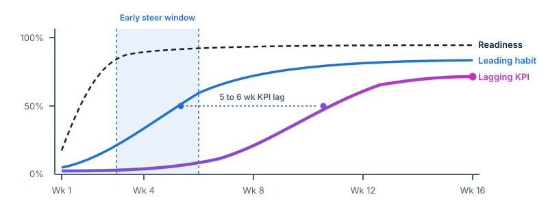
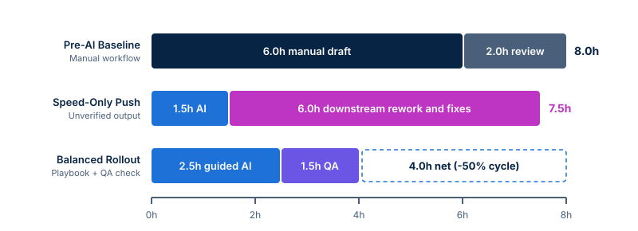

<!-- course-title: Measuring Transformation Change -->
<!-- course-theme: roi-alt-theme -->

<!-- layout: title -->


Measuring Transformation Change

# Chapter 2: Measuring Change Management Effectiveness

---

# Chapter 2: Objectives

- Measure change management progress using balanced leading and lagging indicators
- Differentiate leading adoption indicators from lagging business outcomes across a rollout
- Evaluate telemetry and workflow integration signals for AI assistants and coding agents
- Measure productivity, output quality, and employee sentiment responsibly without eroding trust
- Establish reliable pre-rollout baselines while filtering out misleading vanity metrics
- Build a balanced change measurement scorecard for a technology transformation initiative

---

<!-- layout: navigation -->
# Chapter 2

- **Leading Adoption Indicators vs. Lagging Business Outcomes**
- Telemetry and Workflow Integration for AI Tools
- Measuring Productivity, Quality, and Sentiment Responsibly
- Establishing Baselines and Avoiding Vanity Metrics
- Group Activity: Building a Change Measurement Scorecard

---

<!-- layout: 2-column -->
# Leading Adoption Indicators vs. Lagging Outcomes

### Leading Adoption Indicators
- **Predictive and controllable** during weeks 1 through 6 of a rollout
- Measure whether people have the clarity, habits, and workflow norms to succeed
- Examples: weekly cohort habit rate, approved playbook usage, peer verification checks
- Give managers an early warning while there is still time to coach and remove friction

### Lagging Business Outcomes
- **Confirmative and delayed** until weeks 8 through 24 or quarterly close
- Measure whether changed behaviors actually moved operational or financial KPIs
- Examples: net cycle time, cost per resolution, release velocity, proposal win rate
- Prove ROI to executive sponsors once habits stabilize across a full team

<!-- below-columns -->

> [!IMPORTANT]
> Managing a transformation on lagging KPIs alone is like steering by watching the wake - by the time Q3 productivity misses, the rollout stalled two months earlier.

---

<!-- layout: stacked -->
# The Signal Timing Gap Across a Rollout

- Readiness signals move in days, behavioral habits build over weeks, and business KPIs trail by a month or more
- Leaders who expect hard P and L savings in Week 3 often panic and mandate counterproductive usage quotas
- Weeks 3 through 6 form the **early steer window** where stagnant habit curves tell you exactly where to intervene



---

# Pairing Every Lagging KPI with Leading Signals

| Rollout Phase | Leading Change Signal (Weeks 1 to 8) | What Manager Action It Triggers | Lagging Business KPI Predicted (Weeks 8 to 16) |
| :--- | :--- | :--- | :--- |
| **Readiness** | % of target users clear on data-sharing rules and workflow templates | Clarify approved data tiers with Security; embed examples in team SOPs | Faster time-to-first-habit; zero shadow-AI policy incidents |
| **Workflow Habit** | % of cohort using Copilot, Claude, or Gemini in 3+ core tasks per week | Pair low-adoption pods with peer champions; simplify intake prompts | 20% to 30% reduction in routine ticket, rubric, or draft turnaround |
| **Verification** | % of agent-assisted PRs or briefs passing peer review on first check | Refine verification checklists; coach on task scoping before delegation | Stable or improved defect escape rate and rework hours |

> [!TIP]
> For every lagging KPI on an executive dashboard, assign at least two leading behavioral indicators owned by frontline managers.

---

<!-- layout: navigation -->
# Chapter 2

- Leading Adoption Indicators vs. Lagging Business Outcomes
- **Telemetry and Workflow Integration for AI Tools**
- Measuring Productivity, Quality, and Sentiment Responsibly
- Establishing Baselines and Avoiding Vanity Metrics
- Group Activity: Building a Change Measurement Scorecard

---

<!-- layout: 3-column -->
# Three Tiers of AI Rollout Data

### 1. Vendor Admin Telemetry
- Built-in consoles such as Microsoft 365 Copilot Dashboard, GitHub Copilot metrics, and Claude or Gemini admin logs
- Tracks active days, feature surfaces used, and cohort retention
- **Limitation:** sees tool touchpoints, not whether the output solved a real business problem

### 2. Workflow System Signals
- Operational timestamps inside Jira, GitHub, ServiceNow, CRM, or applicant tracking systems
- Tracks cycle time, review turnaround, reopen rates, and attachment of required artifacts
- **Strength:** reveals whether daily work actually moved faster and cleaner end to end

### 3. Human Context Audits
- Sampled output reviews, 15-minute cohort retros, and manager coaching notes
- Tracks *how* people delegate tasks, catch hallucinations, and share working playbooks
- **Strength:** explains *why* telemetry shifted and surfaces hidden workflow friction

---

# Do Now: Audit a Month-One AI Dashboard

Try this three-minute diagnosis before we unpack telemetry traps.

```text
Month-1 Vendor Snapshot (400 Licenses across Engineering and Operations):
- Activated seats (logged in >=1 time):       91%
- Avg chat prompts per active user:           28 prompts / day
- Coding agent inline suggestion acceptance:  44%
- Net ticket and PR cycle time vs. baseline:  4% slower than prior quarter
```

- The vendor rep calls Month 1 a breakout win; your COO asks why delivery actually slowed down
- Write down one **healthy explanation** and one **troubled workflow explanation** for `28 prompts / day` and `44% inline acceptance`

---

# Reading Chat Assistant vs. Coding Agent Telemetry

- Raw vendor telemetry misleads when leaders confuse high tool volume with workflow proficiency
- **Enterprise Chat and Workspace AI (Claude, Gemini, Microsoft 365 Copilot):**
  - *Misleading signal:* raw prompt count per user (25 rapid prompts often mean someone is fighting unhelpful outputs)
  - *Stronger signal:* **active days per week** (3+ days/wk) and **in-workflow surface use** inside docs, sheets, or project workspaces
- **Coding Agents (GitHub Copilot, Claude Code, IDE Agents):**
  - *Misleading signal:* inline **acceptance rate** in isolation (accepting noisy code inflates acceptance while creating cleanup work)
  - *Stronger signal:* **code survival rate** (accepted code still intact 14 to 30 days post-merge), test coverage, and PR review duration

> [!NOTE]
> High tool activity paired with flat workflow throughput is a diagnostic clue: people are experimenting, not integrating.

---

<!-- layout: card-layout -->
# Four Signs of Real Workflow Integration

### Embedded Team Artifacts
- Prompt patterns, verification checklists, and agent configurations live inside the repo, ticket template, or SOP where work starts.
- Teams stop treating AI as a separate browser tab they remember to visit only when idle.

### Visible Handoff Standards
- Pull requests, escalation notes, and hiring rubrics carry structured fields that downstream reviewers expect to see.
- Colleagues build shared norms around citing sources and flagging AI-generated sections that need domain sign-off.

### Multi-Week Cohort Persistence
- At least 60% to 70% of users active in Week 2 remain active in Weeks 8 and 12 without reminder blasts.
- Habit sticks because the redesigned workflow is genuinely easier than the legacy manual path.

### Maturing Support Questions
- Help-desk and Slack questions shift from “How do I get access?” to “How do we connect the agent to our staging test suite?”
- Friction moves from basic tool literacy to deeper process optimization.

---

<!-- layout: navigation -->
# Chapter 2

- Leading Adoption Indicators vs. Lagging Business Outcomes
- Telemetry and Workflow Integration for AI Tools
- **Measuring Productivity, Quality, and Sentiment Responsibly**
- Establishing Baselines and Avoiding Vanity Metrics
- Group Activity: Building a Change Measurement Scorecard

---

<!-- layout: stacked -->
# Why Drafting Speed Alone Misleads

- Measuring only initial drafting or coding speed hides the **downstream rework tax** paid by reviewers, QA, and managers
- Unverified AI output shrinks creation time from 6.0 hours to 1.5 hours while ballooning cleanup to 6.0 hours
- True productivity tracks **net end-to-end cycle time** from intake to verified, production-ready delivery



---

# Measuring Productivity Beyond “Hours Saved”

- Self-reported “I saved 3 hours this week” surveys rarely reconcile with actual department output
  - Users recall fast first drafts vividly while forgetting 40 minutes spent debugging subtle agent errors
  - Ten-minute time fragments evaporate into email and meetings unless leaders intentionally reallocate freed capacity
- Anchor productivity measurement on three verifiable signals instead:
  - **End-to-end cycle time:** elapsed calendar or active hours from request intake to verified completion
  - **Cohort throughput:** completed proposals, resolved Tier-2 tickets, or shipped stories at constant headcount
  - **Capacity reinvestment:** documented shift of freed hours into higher-value work (such as proactive customer calls or test automation)

---

<!-- layout: 2-column -->
# Pairing Quality Guardrails with Sentiment Pulses

### Output Quality Guardrails
- **First-time pass rate** in peer code review, QA audit, or legal compliance
- **Rework loops:** number of revision rounds or redlines required before sign-off
- **14-day survival or reopen rate:** merged code that stays intact; support tickets that stay closed
- **Sampled accuracy:** periodic blind review of 20 outputs against domain standards

### Employee Sentiment and Friction
- **Policy confidence:** “I know clearly what internal data is safe to use with AI”
- **Drudgery vs. burden:** “These tools reduce repetitive toil rather than adding review fatigue”
- **Task fit:** “AI helps me deliver higher-quality work on my core weekly responsibilities”
- **Psychological safety:** “My manager gives us room to learn and share what does not work”

---

# Surveillance vs. Responsible Measurement

- Nothing destroys transformation trust faster than employees suspecting AI telemetry will drive stack rankings or layoffs
  - Individual prompt monitoring triggers **performative usage** - people run dummy queries on Friday afternoon just to turn a dashboard green
  - High performers hide time-saving workflows if they fear success will simply raise next quarter’s individual quota
- Protect psychological safety with three non-negotiable governance rules:
  - **Aggregate by cohort:** report adoption and productivity in groups of 8 to 10+ employees, never on individual leaderboards
  - **Publish a Measurement Charter:** state upfront which signals are collected, who sees them, and what decisions they inform
  - **Reward playbooks, not prompt volume:** recognize people who document verified workflows that lift the whole team

> [!CAUTION]
> Never tie individual performance ratings or bonuses to raw AI usage counts. Evaluate people on verified work outcomes and collaborative enablement.

---

<!-- layout: 2-column -->
# Example: A Plain-Language Measurement Charter

### What We Publish to Every Cohort
- **Signals collected:** weekly active habit days, workflow cycle-time medians, and anonymized QA or PR pass rates
- **Aggregation floor:** reported strictly in cohorts of **10+ employees** - never by individual name or stack rank
- **Decisions informed:** spotting broken templates, policy ambiguity, and where to focus Week-4 coaching clinics

### Lines Leadership Will Never Cross
- Never inspect individual prompt transcripts outside a formal, documented security incident protocol
- Never tie raw prompt totals, token counts, or AI-code ratios to performance reviews, bonuses, or headcount cuts
- Co-sign this one-page charter with HR, Legal, and employee representatives **before** Day-1 telemetry goes live

---

<!-- layout: navigation -->
# Chapter 2

- Leading Adoption Indicators vs. Lagging Business Outcomes
- Telemetry and Workflow Integration for AI Tools
- Measuring Productivity, Quality, and Sentiment Responsibly
- **Establishing Baselines and Avoiding Vanity Metrics**
- Group Activity: Building a Change Measurement Scorecard

---

<!-- layout: 2-column -->
# Vanity Metrics vs. Actionable Change Metrics

### Vanity Metrics (Look Good, Hide Trouble)
- Cumulative all-time prompts or tokens consumed since launch day
- Total seats provisioned or one-time launch login percentage
- Immediate post-webinar “excitement” scores before real task use
- Total lines of agent code generated without survival or defect tracking

### Actionable Metrics (Drive Decisions)
- Week-4, Week-8, and Week-12 active habit rate within target roles
- Median net cycle time on named workflows vs. pre-rollout baseline
- Ratio of first-pass review approvals to downstream rework hours
- Percentage of squads running updated SOPs with active manager coaching

<!-- below-columns -->

> [!TIP]
> Apply the **Tuesday Morning Test**: if this metric drops 20% next Tuesday, do we immediately know *which workflow* is stuck and *what action* to take? If not, cut it.

---

<!-- layout: card-layout -->
# Four Ways to Capture a Reliable Baseline

### 1. Historical System Logs
- Pull the prior 60 to 90 days of PR cycle times, ticket resolution durations, or proposal turnarounds before rollout begins.
- Use medians alongside averages so two extreme outages do not skew your starting benchmark.

### 2. Staggered Rollout Waves
- Launch Wave 1 to half of a function while Wave 2 continues on the legacy workflow for 30 to 45 days.
- Compare both cohorts side by side to isolate real AI impact from seasonal volume swings.

### 3. Time-Boxed Task Audits
- When historical timestamps do not exist, ask 10 to 15 practitioners to log draft and review effort across five recurring tasks in Week 0.
- Repeat the exact same task audit at Day 60 to measure concrete effort and rework shifts.

### 4. Pre-Enablement Friction Pulse
- Run a four-question baseline check on toil, policy clarity, and review bottlenecks before training starts.
- Track movement on those exact four items at Day 30 and Day 90 instead of asking generic satisfaction questions.

---

# Controlling Confounding Noise in Rollout Data

- Raw before-and-after numbers can mislead when external workload conditions shift mid-quarter
  - Holiday freezes, product launches, or hiring waves alter cycle times regardless of AI usage
  - Normalize comparisons by **task tier** (such as medium-complexity PRs or Tier-2 escalations) rather than mixing trivial requests with major incidents
- Document every baseline and target in a compact, auditable measurement spec:

```text
Workflow:        Tier-2 Escalation Summary and Root-Cause Draft (Claude / Copilot)
BaselineSource:  ServiceNow prior 60 days (n = 1,420 Tier-2 tickets)
BaselineValues:  48m median handle time | 89% QA pass | 14% ticket reopen rate
ControlGroup:    Wave 2 cohort (45 specialists) on legacy workflow Days 1-30
Day60Targets:    34m median handle time | >=90% QA pass | <=12% reopen rate
```

---

<!-- layout: navigation -->
# Chapter 2

- Leading Adoption Indicators vs. Lagging Business Outcomes
- Telemetry and Workflow Integration for AI Tools
- Measuring Productivity, Quality, and Sentiment Responsibly
- Establishing Baselines and Avoiding Vanity Metrics
- **Group Activity: Building a Change Measurement Scorecard**

---

<!-- layout: 2-column -->
# Group Activity: Building a Change Measurement Scorecard

### Scenario Options (15 Minutes)
Select one rollout for your table group to govern over the next 90 days (or use an active rollout from a participant’s organization):
- **Option A (Engineering):** Rolling out coding agents (GitHub Copilot or Claude Code) to 120 developers maintaining core product services
- **Option B (HR and Talent):** Rolling out enterprise assistants (Claude, Gemini, or Copilot) to 80 recruiters and HR business partners
- **Option C (Customer Operations):** Rolling out workspace AI to 150 Tier-2 support and account onboarding specialists

### Group Deliverable
- Complete the **5-Slot Change Measurement Scorecard** for Day 30, Day 60, and Day 90 reviews
- Name **two tempting vanity metrics** an executive might request for your scenario and write one sentence explaining why your group rejected them

---

# Worked Example: Calibrating One Scorecard Row

- Before filling your table’s five slots, compare a vague entry against an actionable cohort-level entry on a **Commercial RFP Proposal** rollout:

```text
Vague Row (Fails the Tuesday Morning Test):
  Slot 2 Leading Habit: "Increase AI usage on proposals" | Source: "Survey" | Target: "High"

Calibrated Row (Drives Week-4 Manager Action):
  Slot 2 Leading Habit: % of proposal leads (cohort n = 24) generating first-pass RFP
                        compliance matrices from the approved security KB >= 2x / week
  Data Source:          Workspace AI admin active-surface log + CRM "AI-Matrix" tag
  Baseline Method:      0% workflow habit at Week 0 (Wave 2 cohort of 12 held as control)
  Day-90 Target:        >= 70% weekly cohort persistence by Week 8
```

---

# Scorecard Blueprint for Your Table Group

| Scorecard Slot | Metric Definition (Cohort-Level) | Data Source | Baseline Method | Day-90 Target |
| :--- | :--- | :--- | :--- | :--- |
| **1. Readiness Signal (Wk 1 to 3)** | *Policy clarity and workflow setup* | | | |
| **2. Leading Habit (Wk 3 to 8)** | *Recurring weekly use in named task* | | | |
| **3. Lagging Productivity KPI** | *End-to-end cycle time or throughput* | | | |
| **4. Quality / Risk Guardrail** | *First-pass review, survival, or QA rate* | | | |
| **5. Trust and Sentiment Pulse** | *Toil reduction and psychological safety* | | | |

> [!IMPORTANT]
> Keep the scorecard tight: five balanced, cohort-level signals that managers actually review beat twenty metrics buried in a spreadsheet.

---

<!-- layout: 2-column -->
# Activity Debrief: Stress-Testing Your Scorecard

### Peer Swap Challenge (5 Minutes)
Pair up with another table and audit their scorecard through two lenses:
- **The Gaming Test:** Could a stressed team push the Leading Habit number to 90% in ten minutes without improving real work?
- **The Slop Catcher:** If AI output volume doubles tomorrow while accuracy drops, which exact guardrail turns yellow first?

### Fixes That Strengthen Any Scorecard
- Replacing “self-reported hours saved” with **system cycle-time medians** or staggered Wave-1 vs. Wave-2 comparisons
- Specifying **cohort aggregation (10+ users)** explicitly so HR, works councils, and employees trust the dashboard
- Naming the **frontline owner** who acts when a leading indicator stalls in Week 4

---

# What You Learned

- Measured change management progress using balanced leading and lagging indicators
- Differentiated leading adoption indicators from lagging business outcomes across a rollout
- Evaluated telemetry and workflow integration signals for AI assistants and coding agents
- Measured productivity, output quality, and employee sentiment responsibly without eroding trust
- Established reliable pre-rollout baselines while filtering out misleading vanity metrics
- Built a balanced change measurement scorecard for a technology transformation initiative

---

# Quiz 1 of 3

**Six weeks into a coding agent rollout, vendor telemetry shows a 42% inline suggestion acceptance rate, yet engineering managers report no improvement in sprint velocity. Which metric combination best diagnoses what is happening?**

- A. Cumulative lines of code generated since launch day and total licenses assigned
- B. Individual developer prompt rankings paired with town hall attendance logs
- C. 14-day merged code survival rate, PR review turnaround time, and rework revision rounds compared against a pre-rollout baseline
- D. A one-question survey asking developers whether they find AI technology exciting

---

# Quiz 1: Answer

**Six weeks into a coding agent rollout, vendor telemetry shows a 42% inline suggestion acceptance rate, yet engineering managers report no improvement in sprint velocity. Which metric combination best diagnoses what is happening?**

**Correct: C.** 14-day merged code survival rate, PR review turnaround time, and rework revision rounds compared against a pre-rollout baseline

- High inline acceptance with flat velocity often signals a downstream rework bottleneck where unverified code is rewritten during review
- Pairing code survival with PR review duration and revision loops reveals whether speed gains at the keyboard are being lost in cleanup
- Cumulative code volume (A) and excitement surveys (D) are classic vanity metrics
- Individual prompt rankings (B) incentivize performative usage and erode psychological safety

---

# Quiz 2 of 3

**IT turned on 400 enterprise AI licenses last Monday before L and D or Operations captured a baseline. How can the transformation lead still establish a credible comparison without eroding employee trust?**

- A. Inspect individual employee chat transcripts to estimate how fast each person worked before launch
- B. Pull the prior 60 to 90 days of historical workflow cycle-time and QA logs, compare Wave 1 against a staggered Wave 2 cohort, and report behavioral metrics in cohorts of 10+
- C. Cancel all measurement until next year’s contract renewal and rely on executive anecdotes
- D. Require every employee to submit a daily timesheet justifying at least one hour saved by AI

---

# Quiz 2: Answer

**IT turned on 400 enterprise AI licenses last Monday before L and D or Operations captured a baseline. How can the transformation lead still establish a credible comparison without eroding employee trust?**

**Correct: B.** Pull the prior 60 to 90 days of historical workflow cycle-time and QA logs, compare Wave 1 against a staggered Wave 2 cohort, and report behavioral metrics in cohorts of 10+

- Historical operational logs in ticketing, CRM, or Git systems exist prior to launch and provide objective cycle-time baselines
- A staggered Wave 2 cohort acts as a live control group against seasonal workload noise
- Cohort-level aggregation (10+ users) preserves psychological safety while giving managers actionable signals
- Transcript surveillance (A) and mandatory daily justification logs (D) destroy trust and trigger gaming

---

<!-- layout: 2-column -->
# Quiz 3 of 3: Discussion

### Prompt
At the Day-60 steering committee, a vendor survey reports that employees using Gemini and Copilot save an average of **“4.2 hours per week.”** The CFO pushes back: **“If 500 people saved 2,100 hours a week, why are customer onboarding backlogs and overtime hours unchanged?”**

### Discuss
- Why do self-reported “hours saved” surveys fail to show up in operational backlogs?
- How would you redesign the scorecard to measure real capacity and net cycle time?
- What role do managers play in turning freed 15-minute fragments into business value?

---

<!-- layout: 2-column -->
# Quiz 3: Discussion Points

**At the Day-60 steering committee, a vendor survey reports that employees save “4.2 hours per week,” yet onboarding backlogs and overtime are unchanged.**

### Strong Answers Mention
- **Time-fragment evaporation:** saving 10 minutes on scattered emails rarely consolidates into completed onboarding cases without workflow redesign
- **Unmeasured rework:** users count fast first drafts while overlooking downstream review and correction time
- **Workflow metrics over surveys:** shifting to end-to-end onboarding cycle time, cases completed per cohort, and QA pass rates
- **Intentional reinvestment:** managers explicitly dedicating freed capacity to backlog burn-down or proactive client check-ins

### Watch For
- Dismissing employee survey feedback entirely instead of reframing it as a perceived-usefulness signal
- Promising immediate headcount reductions to appease the CFO, which freezes adoption overnight
- Blaming individual employees rather than fixing workflow handoffs and capacity planning

---

# Questions and Answers

Questions?
