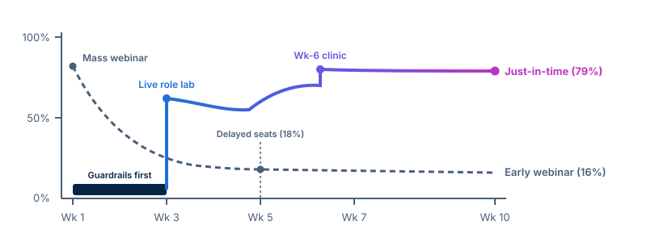
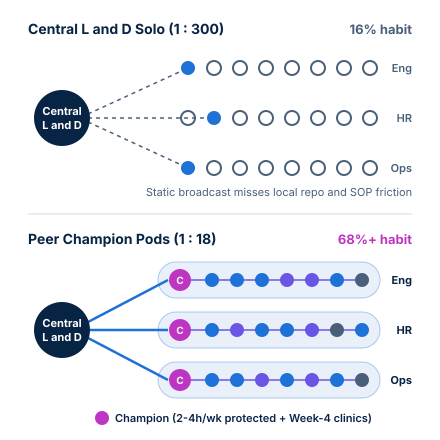

<!-- course-title: Measuring Transformation Change -->
<!-- course-theme: roi-alt-theme -->

<!-- layout: title -->


Measuring Transformation Change

# Chapter 3: Designing Training for Behavioral Change

---

# Chapter 3: Objectives

- Design role-based training programs that drive sustained behavioral adoption
- Position training alongside sponsorship, communication, and coaching in change management models
- Explain why generic feature demos fail to shift daily workflows and habits
- Structure role-based enablement pathways for Copilot, Claude, Gemini, and coding agents
- Diagnose root causes when an existing enablement plan stalls after initial training
- Design a role-based AI enablement blueprint tailored to real job workflows

---

<!-- layout: navigation -->
# Chapter 3

- **Where Training Fits in Change Management Models**
- Why Tool Demos Fail to Shift Daily Workflows
- Role-Based Enablement for Copilot, Claude, Gemini, and Coding Agents
- Do-Now: Diagnosing a Stalled Enablement Plan
- Group Activity: Designing a Role-Based AI Enablement Blueprint

---

# Training Solves Skill Gaps, Not Will or System Gaps

- Training builds **Knowledge and Ability**, yet organizations routinely ask L and D to carry the entire change plan alone
- Mapping Prosci’s **ADKAR** milestones clarifies where training leads and where leadership or operations must act first:

| Change Milestone | Core Adoption Question | Primary Owner | Why Training Cannot Substitute |
| :--- | :--- | :--- | :--- |
| **Awareness** | Why are we changing how we work now? | Executive Sponsor | An instructor cannot invent business urgency |
| **Desire** | Is it safe and worthwhile for *my* role? | Frontline Manager | Classroom demos cannot remove fear or quota pressure |
| **Knowledge** | How do I scope, prompt, and verify safely? | **L and D and SMEs** | **Core instructional design sweet spot** |
| **Ability** | Can I execute under real deadline pressure? | **L and D and Coaches** | **Requires guided practice on real work, not slides** |
| **Reinforcement** | Do team reviews and SOPs reward the habit? | Managers and Ops | Skills fade fast if legacy workflows stay easier |

> [!IMPORTANT]
> Sending skeptical or policy-blocked employees to a mandatory AI workshop treats a sponsorship or governance gap with a classroom Band-Aid.

---

<!-- layout: stacked -->
# Timing Trap: Why Premature Mass Training Evaporates

- Running company-wide AI webinars weeks before licenses, data rules, or workflow access unlock guarantees steep skill decay
- Unpracticed prompting and agent-delegation concepts drop below 20% recall before delayed tool access even arrives
- Just-in-time enablement locks in guardrails first, launches hands-on labs as seats open, and reinforces habits in Week 6



---

<!-- layout: card-layout -->
# Four Preconditions Before Any Cohort Enters Training

### 1. Active Sponsor Framing
- A business leader - not L and D - opens the cohort by naming the operational bottleneck the team is solving this quarter.
- Learners arrive knowing the rollout is a real priority rather than an optional side experiment.

### 2. Plain-Language Data Card
- Security and Legal publish a one-page role guide showing concrete green, yellow, and red data examples.
- Instructors spend session time building workflows instead of fielding forty minutes of compliance anxiety.

### 3. Verified Live Access
- Every participant confirms working access to Copilot, Claude, Gemini, or their IDE agent 48 hours before class.
- Watching a neighbor type because an access ticket is still pending kills momentum on day one.

### 4. Manager-Protected Practice
- Frontline managers explicitly reserve two hours in the following sprint for the team to refactor one recurring task.
- Without protected practice space, urgent legacy queues swallow fragile new habits by Wednesday afternoon.

---

<!-- layout: 3-column -->
# Example: The One-Page Green, Yellow, and Red Data Card

### Green: Safe in Enterprise AI
- Public docs, published HR policies, job postings, and open-source or vendor documentation
- Sanitized templates and internal repos inside **approved enterprise tenants** with zero model-training retention

### Yellow: Sanitize and Verify
- Escalation threads, interview notes, or financial tables **after stripping PII, client names, and account IDs**
- Mandatory human SME check before any drafted output leaves the internal team workspace

### Red: Never Enter in Prompts
- Raw customer PII, credentials or API keys, unreleased M and A or pay files, and privileged legal advice
- Any company task pasted into personal or consumer-tier AI accounts

<!-- below-columns -->

> [!TIP]
> Co-signing three role-specific examples per column with Security turns a 14-page Legal PDF into a three-minute pre-work check.

---

<!-- layout: navigation -->
# Chapter 3

- Where Training Fits in Change Management Models
- **Why Tool Demos Fail to Shift Daily Workflows**
- Role-Based Enablement for Copilot, Claude, Gemini, and Coding Agents
- Do-Now: Diagnosing a Stalled Enablement Plan
- Group Activity: Designing a Role-Based AI Enablement Blueprint

---

<!-- layout: 2-column -->
# Feature Tours vs. Workflow Redesign

### Generic Tool Demo (Feature-Centric)
- Organized around vendor menus, slash commands, and model release notes
- Uses clean toy prompts like “Plan a team offsite” or “Write a sorting function”
- Every example succeeds on the first try inside a curated sandbox
- Leaves the hardest step - fitting messy legacy processes - entirely to the learner

### Workflow Training (Task-Centric)
- Organized around a real job bottleneck like escalation triage or legacy test coverage
- Uses sanitized internal artifacts complete with noisy threads and edge cases
- Intentionally surfaces a hallucination or bad diff so learners practice catching it
- Ends with a verified team playbook ready for Monday morning production work

<!-- below-columns -->

> [!NOTE]
> Employees rarely abandon AI tools because they forgot where the chat button sits; they quit after their first three real-world prompts create unusable work.

---

<!-- layout: stacked -->
# Reclaiming the 60-Minute Enablement Hour

- Who holds the keyboard during training determines whether learners build workflow muscle memory or remain spectators
- Vendor-style feature tours spend 80% of the hour talking through slides, producing high smile-sheet scores and zero team assets
- High-transfer labs cap framing at 10 minutes so cohorts spend 50 minutes building, stress-testing, and peer-verifying real tasks


---

# Teaching the Missing Middle: Decomposition and Verification

- “Prompt-formula cheat sheets” disappoint when they teach clever phrasing instead of **task decomposition, context packing, and verification**
- Effective enablement explicitly contrasts naive one-shot prompting against structured workflow execution:

```text
Demo-Trained Habit (Stalls in Week 2):
"Summarize this customer account and draft a renewal proposal."
-> Generic prose, misses open Sev-1 ticket, invents discount tier -> User abandons tool.

Workflow-Trained Habit (Sustains at Week 12):
1. Context: Attach sanitized ticket log + approved pricing table (Green data tier checked)
2. Decompose: Step A list unresolved risks -> Step B draft options per renewal rubric
3. Verify: Audit dates, SLA figures, and pricing claims against 3-item team checklist
```

- Teaching **when not to use AI** builds more credibility with experienced practitioners than promising effortless automation

---

# Demo: Running a 60-Second Bad-Output Drill

- Try this live as a cohort learner: take 60 seconds to spot **two planted flaws** in the AI draft below before it goes to a client

```text
Source Facts: Tier-2 client outage lasted 95 minutes. Root cause is STILL UNDER
INVESTIGATION by Database Ops. Contract SLA promises a 4-hour update; fee credits
require written VP Finance sign-off.

AI Assistant Draft:
"We sincerely apologize for today's 95-minute disruption caused by an unindexed
database migration script. Per your Tier-2 SLA, we are applying a 10% service
credit to next month's invoice and will send our next status check within 4 hours."
```

- **Planted Flaw 1 (Hallucinated fact):** states an unverified root cause (`unindexed database migration script`) as confirmed truth
- **Planted Flaw 2 (Policy breach):** commits an unauthorized `10% service credit` without VP Finance approval

---

<!-- layout: 3-column -->
# Three Failure Modes of One-and-Done Workshops

### The Toy-Problem Cliff
- Classroom exercises use three-sentence scenarios where all context is neat and self-contained
- Back on the job, learners hit 40-file codebases or ambiguous client threads and conclude the tool cannot handle real work

### Lone-Wolf Prompt Hoarding
- Every employee invents private workarounds from scratch with wildly uneven accuracy
- When top performers keep working prompts on personal notes, team-wide cycle time and quality barely move

### Zero Week-Two Debugging
- Enablement ends Friday afternoon with an LMS completion checkmark and no follow-up clinic
- Minor stumbles with context limits or noisy agent diffs calcify into permanent non-adoption

---

<!-- layout: navigation -->
# Chapter 3

- Where Training Fits in Change Management Models
- Why Tool Demos Fail to Shift Daily Workflows
- **Role-Based Enablement for Copilot, Claude, Gemini, and Coding Agents**
- Do-Now: Diagnosing a Stalled Enablement Plan
- Group Activity: Designing a Role-Based AI Enablement Blueprint

---

<!-- layout: 3-column -->
# Matching Enablement Design to AI Modality

### Enterprise Chat Assistants
- **Tools:** Claude, Gemini, Microsoft 365 Copilot Chat
- **Core skill:** Multi-document synthesis, iterative problem framing, and rubric-driven drafting
- **Lab exercise:** Turning messy policy docs or call notes into structured briefs with cited sources

### Embedded Workspace AI
- **Tools:** Microsoft 365 Copilot in Office apps, Gemini in Google Workspace
- **Core skill:** Cross-artifact orchestration across docs, sheets, slides, and meeting transcripts
- **Lab exercise:** Converting noisy project threads into action trackers while validating owner and formula accuracy

### Coding Agents
- **Tools:** GitHub Copilot, Claude Code, IDE agent workflows
- **Core skill:** Architectural scoping, plan-before-edit loops, test-first delegation, and repo instruction files (persistent team rules stored in the codebase)
- **Lab exercise:** Constraining a multi-file refactor on a real repo, running tests, and auditing line-by-line diffs

---

# Role-Based Curriculum Matrix Across Functions

- Replace generic “AI 101 for Everyone” courses with focused role pathways anchored to two or three high-friction tasks per cohort:

| Role Cohort | Primary AI Modality | Anchor Lab Workflows (Pick 2 to 3) | Required Verification Artifact |
| :--- | :--- | :--- | :--- |
| **Software Engineers** | Coding agents and IDE chat | Legacy unit-test generation, bounded refactoring, PR prep | Repo instructions (`CLAUDE.md` or `copilot-instructions.md`) and diff checklist |
| **HR and Talent** | Enterprise chat and Workspace AI | Structured interview rubrics, job architecture, policy FAQs | Bias, legal compliance, and compensation-band sign-off |
| **Customer Operations** | Workspace AI and Enterprise chat | Escalation thread synthesis, root-cause replies, KB drafts | Account-tier, SLA, and technical accuracy audit |
| **People Managers** | Cross-modality review and coaching | Capacity reallocation, output review norms, 1-on-1 coaching | Team AI working agreement and quality guardrail rubric |

> [!TIP]
> Run the **People Manager Enablement Track** one week *before* frontline cohorts so supervisors know how to review AI-assisted work and coach early friction.

---

<!-- layout: card-layout -->
# The Four-Part Spaced Enablement Cadence

### 1. Pre-Work Setup (15 Min Async)
- Confirm live tool login, review the one-page department data card, and select two recurring tasks from last week’s backlog.
- Skip passive theory lectures so every learner enters the room ready to build on real work.

### 2. Cohort Workflow Lab (75 Min Live)
- Practice decomposing, prompting, and verifying those exact role tasks alongside 15 to 20 peers from the same function.
- Leave the session with one tested team playbook paired with an explicit verification checklist.

### 3. Applied Sprint (Weeks 2 to 3)
- Run the playbook at least three times on live deliverables and post one win plus one failure mode in the team channel.
- Normalize sharing dead-end prompts and agent mistakes so colleagues learn boundary conditions quickly.

### 4. Debugging Clinic (45 Min at Week 4)
- Reconvene with a domain SME and peer champion to troubleshoot edge cases uncovered under real production deadlines.
- Promote proven workflows into the department SOP library and retire patterns that caused downstream rework.

---

# Scaling Through Peer Champions, Not L and D Alone

- Central L and D cannot master every microservice repo, regional regulation, or quarterly model shift solo
- Practitioners trust a respected colleague demonstrating real backlog wins far faster than a static corporate slide deck
- Recruit **1 peer champion per 15 to 20 employees** for domain credibility and coaching patience, not uncritical AI hype
- Protect **2 to 4 hours per week** in writing with managers so champions co-lead Week-4 clinics and maintain team playbooks



---

<!-- layout: navigation -->
# Chapter 3

- Where Training Fits in Change Management Models
- Why Tool Demos Fail to Shift Daily Workflows
- Role-Based Enablement for Copilot, Claude, Gemini, and Coding Agents
- **Do-Now: Diagnosing a Stalled Enablement Plan**
- Group Activity: Designing a Role-Based AI Enablement Blueprint

---

<!-- layout: 2-column -->
# Do-Now: Diagnosing a Stalled Enablement Plan

### Case Vignette (4 Minutes Silent Audit)
Meridian Financial rolled out **Microsoft 365 Copilot, Claude, and GitHub Copilot** to 600 employees eight weeks ago:
- L and D ran a mandatory **90-minute all-hands webinar** in Week 1 covering LLM concepts, prompt acronyms, and vendor demos (**4.6 / 5.0** satisfaction rating)
- Legal emailed a **14-page Acceptable Use PDF**; managers received no separate briefing
- **Week-8 check:** 91% completed the webinar, yet weekly active habit sits at **16%**, and senior engineers report PR review queues are slower than before

### Pair Diagnosis (4 Minutes)
- Circle the **three biggest root causes** behind the drop from 4.6 satisfaction to 16% weekly habit
- Label each flaw: **Precondition gap**, **Demo-vs.-Workflow gap**, or **Reinforcement gap**
- Name the **first intervention** you would run next Monday without buying new tools

---

<!-- layout: 2-column -->
# Do-Now Debrief: Separating Symptoms from Root Causes

### Why the 4.6 Webinar Stalled in Week 2
- **Mixed-audience dilution:** Engineers, HR partners, and analysts watched generic demos detached from their Monday backlog
- **Policy paralysis:** A 14-page legal document with no role examples made cautious staff avoid touching real internal data
- **Missing verification norms:** Developers generated larger diffs without repo instructions or review checklists, shifting toil onto reviewers
- **Bypassed managers:** Supervisors had no coaching guide or sprint buffer to support habit formation

### High-Leverage Monday Interventions
- **Skip “Webinar 2.0”:** Employees do not have an awareness gap - another lecture will deepen cynicism
- Publish a **one-page green/red data card** per function co-signed by Security and department leads
- Stand up **45-minute role debugging clinics** anchored to two named workflows per team
- Establish an engineering **PR verification checklist** and shared repo instruction file immediately

---

<!-- layout: navigation -->
# Chapter 3

- Where Training Fits in Change Management Models
- Why Tool Demos Fail to Shift Daily Workflows
- Role-Based Enablement for Copilot, Claude, Gemini, and Coding Agents
- Do-Now: Diagnosing a Stalled Enablement Plan
- **Group Activity: Designing a Role-Based AI Enablement Blueprint**

---

<!-- layout: 2-column -->
# Group Activity: Designing a Role-Based AI Enablement Blueprint

### Your Design Brief (15 Minutes)
Keep your table’s target function or active organization rollout from Chapter 2 (or choose one below) and design a **4-week role-based enablement pathway** built to move sustained weekly adoption past 65%:
- **Cohort A (Engineering):** 120 product engineers adopting GitHub Copilot and Claude Code on legacy and core services
- **Cohort B (HR and Talent):** 80 recruiters and HR business partners adopting Claude, Gemini, or Copilot
- **Cohort C (Customer Operations):** 150 Tier-2 support and onboarding specialists adopting Workspace AI and chat assistants

### Table Deliverable
- Complete the **6-Block Enablement Blueprint** on the next slide
- Explicitly name **one traditional training activity your team is cutting** to free up learner and SME time for workflow labs

---

# Enablement Blueprint Canvas

| Blueprint Block | Design Question Your Plan Must Answer | Your Cohort Plan |
| :--- | :--- | :--- |
| **1. Target Role and 2 Workflows** | *Which two recurring, high-friction tasks anchor the cohort?* | |
| **2. Week-0 Preconditions** | *What sponsor framing, 1-page data card, and access check happen first?* | |
| **3. Week-1 Workflow Lab (75m)** | *What real artifact do learners build, break, and verify hands-on?* | |
| **4. Verification Guardrail** | *What checklist, rubric, or repo file prevents slop and rework?* | |
| **5. Manager and Champion Role** | *How is practice time protected in Weeks 2 to 3 and coached by peers?* | |
| **6. Week-4 Debugging Clinic** | *Which leading signal from Chapter 2 tells you what to troubleshoot?* | |

> [!IMPORTANT]
> Every block in your enablement blueprint should directly move at least one Leading Indicator or Quality Guardrail from your Chapter 2 scorecard.

---

<!-- layout: 2-column -->
# Activity Debrief: Auditing Your Blueprint for Transfer

### Peer Blueprint Audit (5 Minutes)
Swap blueprints with another table and test their design against three transfer checks:
- **The 48-Hour Artifact Test:** Does every participant walk out of Week 1 with a tested template or configuration they will use before Wednesday?
- **The Bad-Output Drill:** Where in the lab do learners intentionally catch a hallucinated policy, subtle code bug, or unsafe data paste?
- **The Crunch-Week Test:** When customer queues or sprint deadlines spike in Week 2, what keeps learners from reverting to manual habits?

### Common Upgrades Before Launch
- Cutting scope from six shallow prompt demos down to **two end-to-end workflows practiced thoroughly**
- Briefing managers **before** Week 1 so team code reviews and QA audits expect the new verification standard
- Assigning a named peer champion to curate Week-4 clinic lessons into a shared playbook

---

# What You Learned

- Designed role-based training programs that drive sustained behavioral adoption
- Positioned training alongside sponsorship, communication, and coaching in change management models
- Explained why generic feature demos fail to shift daily workflows and habits
- Structured role-based enablement pathways for Copilot, Claude, Gemini, and coding agents
- Diagnosed root causes when an existing enablement plan stalled after initial training
- Designed a role-based AI enablement blueprint tailored to real job workflows

---

# Quiz 1 of 3

**Four weeks after launching Claude and Microsoft 365 Copilot to Finance, telemetry shows low weekly usage. In focus groups, analysts say they know how the chat interface works but worry they might violate confidentiality rules if they paste client spreadsheets. What is the right intervention?**

- A. Require all Finance analysts to retake the 60-minute introductory prompt-engineering webinar
- B. Partner with Security and Finance leadership to publish a one-page green/yellow/red data card, then run a 45-minute hands-on clinic using approved sanitized financial templates
- C. Revoke licenses immediately and conclude that Finance workflows cannot benefit from Generative AI
- D. Send daily automated reminder emails urging analysts to submit at least ten prompts per day

---

# Quiz 1: Answer

**Four weeks after launching Claude and Microsoft 365 Copilot to Finance, telemetry shows low weekly usage. In focus groups, analysts say they know how the chat interface works but worry they might violate confidentiality rules if they paste client spreadsheets. What is the right intervention?**

**Correct: B.** Partner with Security and Finance leadership to publish a one-page green/yellow/red data card, then run a 45-minute hands-on clinic using approved sanitized financial templates

- The root barrier is **policy ambiguity (Desire / Readiness)** paired with missing domain workflow templates, not ignorance of chat buttons
- Resolving the governance precondition first makes the subsequent role-specific clinic safe and immediately applicable
- Repeating a generic webinar (A) wastes time on a skill analysts already have, while prompt quotas (D) encourage dummy queries or risky compliance shortcuts

---

# Quiz 2 of 3

**You are designing an enablement track for 90 software engineers adopting coding agents such as GitHub Copilot and Claude Code. Which session design will drive the strongest sustained workflow transfer and code quality?**

- A. A 90-minute lecture demonstrating twenty slash commands on a brand-new greenfield calculator app
- B. An all-company town hall shared with Marketing and HR covering how large language models predict tokens
- C. A 75-minute cohort lab scoped to two legacy-repo workflows (such as unit-test generation and bounded refactoring), paired with shared repo instruction files, line-by-line diff verification, and a Week-4 debugging clinic
- D. Sending vendor release notes by email and letting every developer invent private review standards independently

---

# Quiz 2: Answer

**You are designing an enablement track for 90 software engineers adopting coding agents such as GitHub Copilot and Claude Code. Which session design will drive the strongest sustained workflow transfer and code quality?**

**Correct: C.** A 75-minute cohort lab scoped to two legacy-repo workflows (such as unit-test generation and bounded refactoring), paired with shared repo instruction files, line-by-line diff verification, and a Week-4 debugging clinic

- Coding agent transfer depends on scoping changes inside real legacy repositories, constraining behavior via shared repo instructions, and rigorously verifying diffs and tests
- Following up with a Week-4 clinic troubleshoots real production edge cases and prevents lone-wolf rework
- Toy greenfield demos (A), mixed-role theory lectures (B), and unguided email links (D) leave the hardest workflow and quality problems unsolved

---

<!-- layout: 2-column -->
# Quiz 3 of 3: Discussion

### Prompt
A VP of Customer Operations pushes back on your role-based enablement blueprint: **“We cannot pull 150 support specialists off live queues for a 75-minute cohort lab and a Week-4 clinic. Just record one 30-minute video on prompt tips and require 100% LMS completion by Friday.”**

### Discuss
- Why will the 30-minute mandatory video cost *more* operational capacity over 90 days than it saves this week?
- How can you stagger cohorts or trim scope to respect live queue coverage without sacrificing hands-on workflow practice?
- Which leading and quality metrics from Chapter 2 would you offer as a pilot checkpoint with the VP?

---

<!-- layout: 2-column -->
# Quiz 3: Discussion Points

**A VP of Customer Operations wants to replace live role labs and clinics with a single 30-minute self-paced prompt video to protect queue coverage.**

### Strong Answers Mention
- **False time economy:** 150 specialists x 30 minutes still spends 75 hours of labor, yet yields ~15% habit retention and higher QA rework on live tickets
- **Operational staggering:** Running 20-person micro-cohorts during off-peak queue windows and focusing on a single high-volume escalation workflow first
- **Pilot proof:** Running Wave 1 with one 20-person pod for 30 days and comparing handle time, QA pass rate, and reopen rate against Wave 2
- **Pre-briefing team leads** so coaching happens inside existing weekly QA reviews rather than extra meetings

### Watch For
- Conceding immediately to a passive video and hoping LMS completion will move ticket resolution times
- Insisting on pulling all 150 specialists off queues simultaneously instead of partnering on operational scheduling
- Arguing from L and D theory rather than framing the trade-off in ticket cycle time, reopen risk, and license waste

---

# Questions and Answers

Questions?
