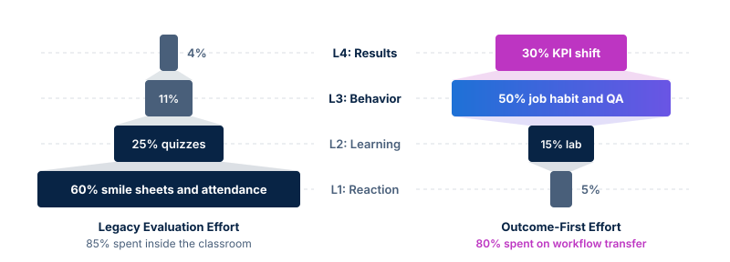
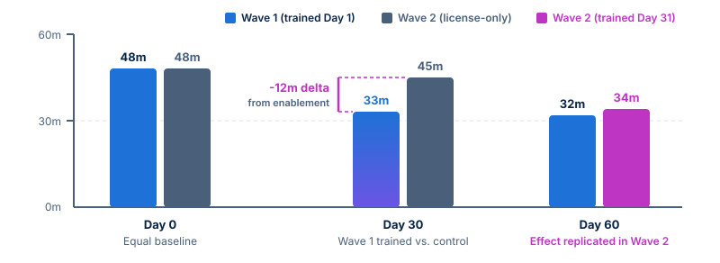

<!-- course-title: Measuring Transformation Change -->
<!-- course-theme: roi-alt-theme -->

<!-- layout: title -->


Measuring Transformation Change

# Chapter 4: Evaluating Training Impact and Sustaining Adoption

---

# Chapter 4: Objectives

- Evaluate training effectiveness and link enablement to measurable business outcomes
- Apply multi-level training evaluation frameworks from learner reaction to organizational impact
- Connect learning metrics to observable on-the-job behavior and operational KPIs
- Design reinforcement, manager coaching, and executive reporting rhythms that sustain adoption
- Evaluate practical methods for attributing business impact to training initiatives
- Create a 90-day measurement and reinforcement plan for an organizational transformation

---

<!-- layout: navigation -->
# Chapter 4

- **Multi-Level Training Evaluation Frameworks**
- Connecting Learning Metrics to On-the-Job Behavior and KPIs
- Reinforcement, Coaching, and Executive Reporting
- Discussion: Attributing Business Impact to Training Initiatives
- Group Activity: Creating a 90-Day Measurement and Reinforcement Plan

---

# Adapting Kirkpatrick’s Four Levels for AI Enablement

- Traditional training evaluation stops at post-class satisfaction scores, leaving leaders blind to whether Copilot, Claude, Gemini, or coding agents changed real work
- Modernizing **Kirkpatrick’s Four Levels** anchors every enablement track to observable workflow transfer:

| Evaluation Level | Core Enablement Question | AI Transformation Signal (Cohort-Level) | Timing |
| :--- | :--- | :--- | :--- |
| **Level 1: Reaction** | Is this relevant and safe for my job? | 2-item pulse on Monday task fit and data-policy clarity | End of lab |
| **Level 2: Learning** | Can learners execute and verify live? | Tested role playbook submitted; planted flaw caught in class | Day 1 |
| **Level 3: Behavior** | Did habits stick under real deadlines? | Weekly workflow habit rate, checklist use, and QA pass rate | Weeks 3 to 8 |
| **Level 4: Results** | Did sustained habits move the KPI? | Net cycle time, throughput, and reopen or defect rate vs. baseline | Days 60 to 90 |

> [!IMPORTANT]
> Design your evaluation **backward** from Level 4 Results down to Level 1 Reaction, then collect evidence **forward** as cohorts progress.

---

<!-- layout: stacked -->
# Inverting the Evaluation Effort Pyramid

- Legacy L and D teams spend roughly 85% of evaluation effort on attendance logs, smile sheets, and trivia quizzes while starving post-training follow-up
- High-impact AI transformation flips that ratio so 80% of measurement effort tracks **Level 3 workflow habits** and **Level 4 operational KPIs**
- Reusing Chapter 2 system telemetry (GitHub, Jira, ServiceNow, ATS) makes Level 3 and Level 4 tracking sustainable without survey fatigue



---

<!-- layout: 2-column -->
# Stopping at Level 4 vs. Calculating Monetary ROI

### Level 4 Operational Impact (Default Standard)
- Measures concrete shifts in cycle time, cases resolved, first-pass QA, and code survival
- Uses native operational metrics that Engineering, HR, and Support VPs already trust
- Appropriate for **90% of role cohorts** where directionally clear operational gains justify continuation

### Phillips Level 5 ROI (Selective Use)
- Converts isolated Level 4 gains into net financial return minus license, SME, and learner labor costs
- Worth the analytical rigor for **enterprise contract renewals, major seat expansions, or executive board reviews**
- Requires conservative contribution discounts and Finance sign-off on valuation formulas upfront

<!-- below-columns -->

> [!WARNING]
> Never multiply self-reported “minutes saved” by average hourly salary and call it Level 5 ROI - CFOs immediately reject unrecovered time fragments as phantom savings.

---

# Defensible Renewal Math When Finance Asks for ROI

- When a renewal board asks for dollar ROI, anchor only on **recovered P and L outlays or verified capacity**, discounted conservatively:
  - **Hard cost avoidance:** reduced overtime, surge contractor hours, outside agency spend, or SLA penalty credits
  - **Verified capacity value:** incremental cases, proposals, or features delivered at constant headcount - multiplied by a conservative contribution share (typically 40% to 50%)

```text
Worked Renewal Check (150-Seat Tier-2 Support Cohort - Annualized):
  Verified Gain:  $290k avoided Q4 contractor surge + $70k lower SLA breach credits = $360k
  Contribution:   50% conservative share credited to AI workflow + enablement       = $180k
  Program Cost:   $54k annual licenses + $36k lab, clinic, and SME labor hours      = $90k
  Net Benefit:    $180k - $90k = +$90k net savings (100% Level-5 ROI)
```

---

<!-- layout: card-layout -->
# Upgrading Levels 1 and 2 from Trivia to Transfer Signals

### 1. Cut Facilitator Charisma Scores
- Replace 15-question speaker smile sheets with two transfer pulses: whether learners have a concrete task ready before Wednesday and whether they know which internal data is safe to include.
- High entertainment ratings routinely mask workshops where learners have no idea how to apply the tool on Monday.

### 2. Retire Token-Theory Quizzes
- Multiple-choice questions on model parameters or prompt acronyms do not predict safe, effective workflow delegation.
- Test judgment on realistic role scenarios rather than vocabulary memorization.

### 3. Grade the Live Playbook Artifact
- Require every participant to leave the 75-minute cohort lab with one working prompt or agent configuration tied to a backlog task.
- If a learner cannot produce a usable workflow artifact with coach support in class, transfer will not happen solo at their desk.

### 4. Score a Seeded Flaw Audit
- Plant one realistic hallucination, policy breach, or subtle logic bug inside every Level 2 lab exercise.
- Verify that participants catch and correct the bad output using their team rubric before marking training complete.

---

<!-- layout: navigation -->
# Chapter 4

- Multi-Level Training Evaluation Frameworks
- **Connecting Learning Metrics to On-the-Job Behavior and KPIs**
- Reinforcement, Coaching, and Executive Reporting
- Discussion: Attributing Business Impact to Training Initiatives
- Group Activity: Creating a 90-Day Measurement and Reinforcement Plan

---

# Building an End-to-End Impact Chain

- Learning metrics earn executive credibility only when connected through a testable **if-then chain** from classroom mastery to business KPIs
- Map each cohort’s Level 2 lab check directly to its Level 3 workflow habit and Level 4 operational target:

```text
Cohort A: Product Engineering (GitHub Copilot and Claude Code)
  L2 Lab Gate   -> 92% submit bounded refactor plan + catch seeded concurrency bug
  L3 Wk-6 Habit -> 68% attach verification checklist on 3+ PRs/wk; 88% 14-day code survival
  L4 Day-90 KPI -> Median PR cycle time drops 4.2d -> 2.8d (-33%) with flat escaped defects

Cohort C: Customer Operations (Workspace AI and Enterprise Chat)
  L2 Lab Gate   -> 95% synthesize noisy Tier-2 thread + catch planted SLA error
  L3 Wk-6 Habit -> 74% apply escalation playbook 3+ days/wk; 91% first-pass QA score
  L4 Day-90 KPI -> Median Tier-2 handle time drops 48m -> 33m (-31%); reopens hold at 11%
```

- Linking every stage gives you an early diagnostic circuit breaker weeks before quarterly KPIs close

---

# Do Now: Diagnose Two Stalled Rollout Pods

- **Pod Alpha (Recruiting, n = 40):** 95% passed the live rubric lab and seeded-flaw check (L2), yet only 18% used AI on live requisitions this week (L3)
- **Pod Beta (Engineering, n = 45):** 91% passed the coding-agent lab (L2) and 78% use the agent 4+ days/week (L3), yet median PR cycle time is 15% *slower* than baseline (L4)
- **3-minute diagnosis:** Does *either* pod need to retake the training workshop - and what is the first operational barrier you would inspect in each pod?


---

<!-- layout: 2-column -->
# Diagnosing Breakpoints Across L2, L3, and L4

### High L2 Mastery, Low L3 Job Habit
- **What data shows:** 90%+ pass the hands-on lab, yet Week-4 cohort usage sits below 25%
- **What it means:** People *can* execute the workflow, but the work environment blocks or punishes using it
- **First places to check:** Missing tool permissions, 14-page legal ambiguity, urgent sprint pressure, or unbriefed managers
- **Wrong response:** Rewriting the workshop slides or forcing cohorts to retake training

### High L3 Job Habit, Flat L4 Business KPI
- **What data shows:** 70%+ of the cohort uses AI 3+ days a week, yet cycle time or throughput stays flat
- **What it means:** Tool activity is occurring without end-to-end workflow gain
- **First places to check:** Downstream review queues, unverified output causing rework, or saved 15-minute fragments evaporating
- **Wrong response:** Pushing higher prompt quotas instead of fixing verification checklists and handoffs

---

<!-- layout: stacked -->
# Isolating Enablement Value from Tool Access Alone

- Skeptical sponsors often ask whether productivity gains came from your workflow labs or simply from buying AI licenses
- Launching in **staggered 30-day waves** turns a normal operational rollout schedule into a clean natural comparison
- When trained Wave 1 outperforms license-only Wave 2 at Day 30 - and Wave 2 replicates that jump after Day-31 training - enablement’s value is unmistakable



---

<!-- layout: 3-column -->
# Three Low-Lift Ways to Capture Level 3 Behavior

### 1. Workflow Artifact Signals
- Track structured fields inside existing tools, such as PR verification checkboxes, escalation summary tags, or rubric attachments
- Measures real protocol adherence automatically without deploying extra surveys

### 2. Sampled Blind QA Audits
- Have SMEs score 15 to 20 anonymized deliverables at Day 0 and Day 45 using the exact same domain rubric
- Confirms whether trained cohorts ship cleaner, safer work without inspecting private chat logs

### 3. Success Case Interviews
- Apply Robert Brinkerhoff’s **Success Case Method** at Week 6: interview 5 top adopters and 5 stalled users for 20 minutes each
- Uncovers concrete workflow wins alongside the exact system barriers holding back the middle 60%

---

<!-- layout: navigation -->
# Chapter 4

- Multi-Level Training Evaluation Frameworks
- Connecting Learning Metrics to On-the-Job Behavior and KPIs
- **Reinforcement, Coaching, and Executive Reporting**
- Discussion: Attributing Business Impact to Training Initiatives
- Group Activity: Creating a 90-Day Measurement and Reinforcement Plan

---

# The 30-60-90 Post-Training Reinforcement Rhythm

- Even the strongest hands-on lab fades within three weeks if learners return to unchanged team norms and silent managers
- Schedule explicit reinforcement handoffs from L and D to frontline operations before Day 1 begins:

| Window | Reinforcement Milestone | Primary Owner | Observable Lock-In Signal |
| :--- | :--- | :--- | :--- |
| **Days 7 to 14** | Protected First-Habit Sprint | Frontline Manager | Every learner runs the new playbook 3x on live tasks |
| **Day 30** | Peer Debugging Clinic | Peer Champion and SME | Edge cases solved; top 2 patterns added to team playbook |
| **Day 60** | Workflow SOP Lock-In | Department Ops Lead | Legacy manual template retired; QA or PR gate updated |
| **Day 90** | Capacity and Renewal Review | Executive Sponsor | Freed hours reallocated to named backlog priorities |

> [!TIP]
> A behavior shift becomes permanent on the day the AI-assisted workflow and verification checklist become the official team SOP rather than an optional side habit.

---

<!-- layout: card-layout -->
# A 10-Minute Biweekly Coaching Card for Managers

### 1. Where Did It Cut Toil?
- Ask which recurring task moved noticeably faster with Copilot, Claude, Gemini, or the coding agent during this sprint.
- Highlighting concrete wins in 1-on-1s signals that leadership values workflow improvement, not just raw ticket volume.

### 2. Where Did Output Break?
- Ask which prompt, synthesis, or multi-file diff missed the mark and forced manual cleanup this week.
- Treating dead ends as normal boundary discovery keeps employees from quietly abandoning the tool after one bad draft.

### 3. Did the Guardrail Hold?
- Review one recent deliverable together against the department’s green/red data card and verification checklist.
- Five minutes of side-by-side spot coaching prevents downstream review bottlenecks far better than policy reminder emails.

### 4. What Should the Team Steal?
- Pick one working prompt pattern or tricky failure case to bring to the peer champion’s Week-4 debugging clinic.
- Turning individual discoveries into shared team playbooks lifts the middle of the cohort rapidly.

---

<!-- layout: 2-column -->
# Activity Reports vs. Executive Impact Briefings

### L and D Activity Report (Gets Cut)
- Leads with total workshops delivered, seat completions, and 4.7 / 5.0 smile-sheet averages
- Averages all departments together, hiding stalled pods behind enthusiastic early adopters
- Treats training delivery as the finish line with no link to operational backlogs
- Leaves L and D defenseless when Finance scrutinizes software and training spend

### Executive Impact Briefing (Drives Action)
- Leads with **Level 4 KPI movement** vs. baseline and **Level 3 cohort habit persistence**
- Flags **yellow and red cohorts early** alongside the specific access, policy, or coaching blocker
- Pairs efficiency gains with **quality and risk guardrails** so leaders trust the speed-up
- Closes with **one or two concrete sponsor decisions** needed to unblock the next wave

---

# Anatomy of a One-Page Executive Readout

- Keep monthly steering-committee updates to a single scannable block linking L2, L3, and L4 signals to clear sponsor actions:

```text
COHORT: Tier-2 Support and Onboarding AI Enablement (n = 150 | Day-60 Readout)
L4 KPI Impact:   Median handle time 48m -> 35m (-27%) | Reopens 14% -> 11% (Guardrail <=12%)
L3 Job Habit:    69% active 3+ days/wk in escalation SOP (Wave 1: 76% | Billing Pod: 31% [RED])
L2 Lab Gate:     93% submitted verified escalation playbook and caught planted SLA error
Root Blocker:    Billing Pod lacks sanitized CRM export permissions (Security ticket #418)
Sponsor Ask:     Approve read-only Billing sandbox by Friday; sign off Wave-2 SOP retirement
```

- Surfacing a red pod early with a named operational fix builds far more executive confidence than presenting an all-green vanity slide

---

<!-- layout: navigation -->
# Chapter 4

- Multi-Level Training Evaluation Frameworks
- Connecting Learning Metrics to On-the-Job Behavior and KPIs
- Reinforcement, Coaching, and Executive Reporting
- **Discussion: Attributing Business Impact to Training Initiatives**
- Group Activity: Creating a 90-Day Measurement and Reinforcement Plan

---

<!-- layout: 3-column -->
# Practical Attribution Without a Laboratory Trial

### 1. Staggered Wave Cuts
- Compare trained Wave 1 against license-only Wave 2 across the exact same 30-day calendar window
- Controls naturally for seasonal demand shifts, product launches, and vendor model updates

### 2. Enablement Dosage Bands
- Compare anonymized cohorts (10+ users) who completed **lab + clinic + manager coaching** against license-only or webinar-only peers
- Demonstrates whether deeper enablement tracks steeper cycle-time and QA gains

### 3. Conservative Contribution Share
- When process cleanup and training land together, ask frontline leads to estimate enablement’s % contribution and apply a confidence discount
- Credible **contribution evidence** beats an implausible claim that training caused 100% of the win

---

<!-- layout: 2-column -->
# Discussion: Attributing Business Impact to Training Initiatives

### Scenario Prompt (10 Minutes)
At the Q3 business review, Tier-2 Support resolution time improved by **28%** and Engineering PR cycle time improved by **22%** following your role-based workflow labs and clinics. However, two other changes occurred in Q3: the AI vendor released a stronger model, and Operations simplified ticket intake forms. A skeptical Finance VP asks: **“How do we know the 400 labor hours spent in L and D labs drove any of this improvement?”**

### Small-Group Tasks
- Frame a **shared-contribution response** that avoids a turf war with IT and Operations while defending enablement’s role
- Name **two concrete cohort comparisons** you can pull from existing telemetry and QA logs to isolate training’s lift
- Identify one common L and D defense that immediately loses credibility with Finance

---

<!-- layout: 2-column -->
# Debrief: Claiming Contribution Credibly

### Moves That Win Finance and Sponsors
- Framing workflow enablement, model quality, and intake cleanup as **jointly necessary** - tools create potential while enablement converts it into verified habit
- Showing **dosage or wave differences** on the *same* upgraded model (for example, coached cohorts cutting handle time 28% vs. 7% in license-only pods)
- Highlighting **risk and rework avoided**: higher first-pass QA and 14-day code survival in trained cohorts vs. ad-hoc users
- Applying a conservative discount when estimating unlocked team capacity

### Credibility Traps to Avoid
- Claiming a 75-minute training lab single-handedly generated 100% of a department’s quarterly productivity gain
- Retreating to “learning impact is intangible” and offering 4.8 satisfaction scores as proof
- Singling out individual employees on slides instead of comparing 10+ user cohorts

---

<!-- layout: navigation -->
# Chapter 4

- Multi-Level Training Evaluation Frameworks
- Connecting Learning Metrics to On-the-Job Behavior and KPIs
- Reinforcement, Coaching, and Executive Reporting
- Discussion: Attributing Business Impact to Training Initiatives
- **Group Activity: Creating a 90-Day Measurement and Reinforcement Plan**

---

<!-- layout: 2-column -->
# Group Activity: Creating a 90-Day Measurement and Reinforcement Plan

### Capstone Brief (15 Minutes)
Bring forward your table’s target cohort or active organization rollout from Chapters 2 and 3 and build a launch-ready **90-Day Measurement and Reinforcement Plan** for your executive sponsor:
- **Cohort A (Engineering):** 120 product engineers adopting GitHub Copilot and Claude Code
- **Cohort B (HR and Talent):** 80 recruiters and HR business partners adopting Claude, Gemini, or Copilot
- **Cohort C (Customer Operations):** 150 Tier-2 support and onboarding specialists adopting Workspace AI and chat assistants

### Table Deliverable
- Complete the **90-Day Measurement and Reinforcement Canvas** on the next slide
- Prepare a **60-second executive pitch** naming your Day-30 circuit breaker (the exact signal that triggers intervention if adoption stalls)

---

# 90-Day Measurement and Reinforcement Canvas

| Time Window | Evaluation Signals (L1 to L4) | Reinforcement and Coaching Action | Named Owner | Cohort Target |
| :--- | :--- | :--- | :--- | :--- |
| **Days 0 to 14** | *Baseline locked; L1 relevance pulse; L2 live playbook and seeded-flaw gate* | *Sponsor kickoff; data card live; manager protects 2h sprint buffer* | | |
| **Days 15 to 30** | *Early L3 weekly workflow habit rate and friction pulse* | *Biweekly manager 1-on-1 check; Week-4 peer debugging clinic* | | |
| **Days 31 to 60** | *L3 persistence; sampled blind QA or 14-day code survival audit* | *Retire legacy manual template; embed verification in team SOP* | | |
| **Days 61 to 90** | *L4 net cycle time vs. Wave-2 control; capacity reinvestment check* | *Executive readout; reallocate freed hours; launch Wave-2 refresh* | | |

> [!IMPORTANT]
> Check the **Named Owner** column carefully: if L and D owns every row past Day 14 without frontline managers and ops leads, adoption will erode under deadline pressure.

---

<!-- layout: 2-column -->
# Activity Debrief: Stress-Testing Your 90-Day Plan

### Executive Sponsor Swap (5 Minutes)
Deliver your 60-second pitch to a partner table and test each plan against three real-world pressures:
- **The Day-30 Stall Drill:** If 95% pass the Level 2 lab but Day-30 weekly habit sits at 21%, who meets on Wednesday morning and what barrier do they check first?
- **The Renewal Defense:** Which side-by-side comparison proves your enablement track outperformed unguided license distribution?
- **The Day-91 Continuity Check:** Which updated SOP, PR template, or QA gate keeps habits alive once formal rollout governance winds down?

### Final Course Takeaways
- Define transformation success as **verified workflow change and business outcomes**, never license counts
- Pair every speed or throughput metric with a **quality guardrail** and **cohort-level trust protections**
- Treat training as one connected system of **preconditions, hands-on workflow labs, coaching, and 90-day measurement**

---

# What You Learned

- Evaluated training effectiveness and linked enablement to measurable business outcomes
- Applied multi-level training evaluation frameworks from learner reaction to organizational impact
- Connected learning metrics to observable on-the-job behavior and operational KPIs
- Designed reinforcement, manager coaching, and executive reporting rhythms that sustain adoption
- Evaluated practical methods for attributing business impact to training initiatives
- Created a 90-day measurement and reinforcement plan for an organizational transformation

---

# Quiz 1 of 3

**Eighty HR business partners and recruiters complete a hands-on AI workflow lab. In class, 94% build a working interview-rubric playbook and catch the planted bias flaw (Level 2), yet Week-5 cohort telemetry shows only 19% weekly usage on live requisitions (Level 3). What should the transformation lead do first?**

- A. Redesign the 75-minute classroom lab from scratch and require all 80 participants to retake it next month
- B. Partner with frontline HR managers to audit post-training workflow barriers - such as unapproved ATS templates, lingering legal sign-off fear, or zero protected sprint time - and remove the blocker
- C. Expand the Level 1 post-class survey from two questions to twenty questions to measure facilitator style
- D. Publish an individual leaderboard ranking recruiters from highest to lowest daily prompt count

---

# Quiz 1: Answer

**Eighty HR business partners and recruiters complete a hands-on AI workflow lab. In class, 94% build a working interview-rubric playbook and catch the planted bias flaw (Level 2), yet Week-5 cohort telemetry shows only 19% weekly usage on live requisitions (Level 3). What should the transformation lead do first?**

**Correct: B.** Partner with frontline HR managers to audit post-training workflow barriers - such as unapproved ATS templates, lingering legal sign-off fear, or zero protected sprint time - and remove the blocker

- A **High L2 / Low L3** pattern proves participants learned *how* to execute the workflow in class but hit an environmental, governance, or manager barrier back on the job
- Fixing the workflow integration or coaching gap unlocks transfer far faster than repeating training people already mastered (A)
- Longer smile sheets (C) ignore post-training reality, and individual prompt leaderboards (D) destroy trust while incentivizing dummy queries

---

# Quiz 2 of 3

**Ahead of an annual coding agent license renewal, the CFO asks for credible proof that your engineering enablement program delivered business impact beyond basic tool access. Which evidence package holds up best under executive scrutiny?**

- A. Multiplying self-reported “minutes saved per day” survey responses by average developer compensation to claim a 540% financial ROI
- B. Reporting 97% cohort lab attendance, 100% LMS quiz completion, and a 4.8 out of 5.0 learner satisfaction rating
- C. Comparing staggered cohorts (trained Wave 1 vs. license-only Wave 2 on comparable repos) across median PR cycle time, 14-day code survival, and escaped defect rates, paired with documented capacity reinvestment
- D. Presenting cumulative lines of AI-generated code written across the company since launch day

---

# Quiz 2: Answer

**Ahead of an annual coding agent license renewal, the CFO asks for credible proof that your engineering enablement program delivered business impact beyond basic tool access. Which evidence package holds up best under executive scrutiny?**

**Correct: C.** Comparing staggered cohorts (trained Wave 1 vs. license-only Wave 2 on comparable repos) across median PR cycle time, 14-day code survival, and escaped defect rates, paired with documented capacity reinvestment

- A staggered Wave-1 vs. Wave-2 comparison isolates enablement’s contribution from seasonal noise and license-only curiosity using native engineering metrics
- Pairing PR cycle time with code survival and defect guardrails proves speed gains did not create downstream rework
- Unverified time-fragment salary math (A) is dismissed by Finance as phantom ROI, while attendance ratings (B) and raw code volume (D) are classic vanity metrics

---

<!-- layout: 2-column -->
# Quiz 3 of 3: Discussion

### Prompt
At Day 45 of a multi-team AI rollout, three cohorts are above 68% weekly workflow habit, while the **Commercial Legal Ops pod sits at 22% [RED]**. A teammate suggests: **“Let’s blend all four pods into one 59% company average on Friday’s executive readout - if we show a red pod, sponsors will think our training failed.”**

### Discuss
- Why does averaging away a stalled cohort backfire at the Day-90 renewal review?
- How do you frame a red cohort on a one-page executive readout so sponsors mobilize to remove the blocker rather than blaming learners or L and D?
- What quick Level-3 check would you run with the Legal Ops lead before Friday’s meeting?

---

<!-- layout: 2-column -->
# Quiz 3: Discussion Points

**A teammate wants to hide a stalled 22% Legal Ops pod inside a blended 59% overall average on Friday’s executive readout.**

### Strong Answers Mention
- **Hidden rot surfaces later:** Legal Ops leaders already feel the stall on the floor; hiding it destroys dashboard credibility when renewal arrives
- **Diagnostic framing:** Reporting `Legal Ops: 22% [RED]` alongside high L2 lab pass rates, the specific workflow or policy blocker, and a concrete **Sponsor Ask**
- **Pre-meeting L3 check:** Conducting two 15-minute Success Case checks and reviewing data-tier permissions with the Legal Ops manager before Friday
- **Executive trust:** Leaders respect transformation teams that spot friction at Day 45 and bring an actionable fix

### Watch For
- Agreeing to mask cohort variance in rolled-up company averages to make L and D look safe in the short term
- Flagging a red cohort on an executive slide *without* diagnosing the root cause or naming a proposed action
- Blaming Legal Ops staff as “resistant to change” when confidentiality rules or template approvals were never resolved

---

# Questions and Answers

Questions?
